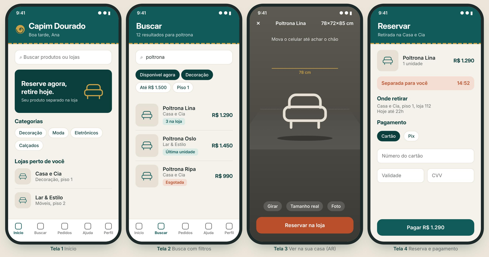
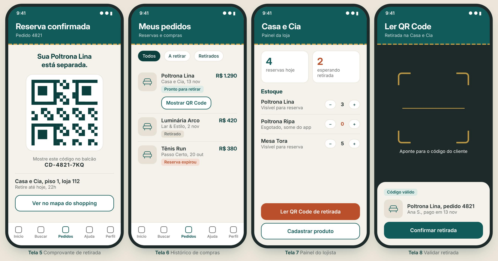

# Zaptos – HACKRUN 2026

Aplicação para integração da jornada de compra digital e física do Capim Dourado Shopping (Desafio 04 – Integração da jornada de compra digital e física).

Centro Universitário Católica do Tocantins – Bacharelado em Engenharia de Software e Tecnólogo em IA.

## Equipe

- Filippe Barbosa Souza Costa
- Késia Vitória Silva Guilherme
- João Victor Marinho de Morais
- Stefani Vitória Teixeira

## Documentação

- [Documentação completa (Word)](docs/Documentacao_Zaptos_Unificada.docx)
- [Documentação completa (PDF)](docs/Documentacao_Zaptos_Unificada.pdf)

## Telas do protótipo





## Stack

- Front-end: HTML, CSS e JavaScript (PWA), com galeria de imagens e medidas dos produtos (3D/AR com `<model-viewer>` fica como evolução futura)
- Back-end: Python (API REST)
- Banco de dados: MySQL
- Pagamentos: PagBank (API de pedidos com divisão de pagamento entre lojista e shopping, sandbox)

## Estrutura do repositório

```
frontend/   PWA (telas do cliente, lojista e admin)
backend/    API Python (catalogo, estoque, pedidos, pagamentos, lojistas, usuarios)
docs/       Documentação e telas do protótipo
```

## Configuração

1. Copie `.env.example` para `.env` e preencha as variáveis (MySQL e PagBank sandbox).
2. Nunca faça commit do `.env` nem de tokens: ele já está no `.gitignore`.

## Como rodar tudo

Sobe o banco (MySQL), a API e o front-end com um comando, usando Docker.

**Pré-requisito:** [Docker Desktop](https://www.docker.com/products/docker-desktop/) instalado e aberto ("Engine running").

1. **Crie o `.env`** na raiz, a partir do modelo:

   ```powershell
   Copy-Item .env.example .env
   ```

   Preencha pelo menos `DB_PASSWORD` (senha do banco que o Docker vai criar; escolha uma) e `SECRET_KEY`. Para gerar a `SECRET_KEY`:

   ```powershell
   py -c "import secrets; print(secrets.token_urlsafe(48))"
   ```

2. **Suba tudo:**

   ```powershell
   powershell -ExecutionPolicy Bypass -File scripts\iniciar.ps1
   ```

   Na primeira vez demora alguns minutos (baixa as imagens e cria o banco com `schema.sql` e `seed.sql`). No fim, o script mostra os endereços:

   - App (cliente e lojista): http://localhost:5173
   - Painel do admin: http://localhost:5173/admin.html
   - Documentação da API: http://localhost:8000/docs

3. **Contas de teste:** estão em [`backend/db/README.md`](backend/db/README.md).

4. **Parar:** `scripts\parar.ps1`. Os dados do banco ficam guardados para a próxima vez.

**Antes da apresentação**, deixe o banco limpo (apaga pedidos, reservas e avisos dos ensaios e carrega o seed de novo; pede confirmação):

```powershell
powershell -ExecutionPolicy Bypass -File scripts\recarregar-banco.ps1
```

Observações:

- As portas 5173 e 8000 precisam estar livres. A porta do banco não é publicada, então um MySQL já instalado na 3306 não atrapalha.
- No Docker, a API entra no banco como `root`, com a senha `DB_PASSWORD` do `.env`. `DB_HOST`, `DB_USER` e `DB_NAME` do `.env` só valem para rodar a API fora do Docker.
- A senha do banco é gravada na primeira vez que ele é criado. Se trocar `DB_PASSWORD` depois, a API não conecta mais: volte a senha antiga ou apague o banco do Docker com `docker compose down -v` (perde os dados) e rode `scripts\iniciar.ps1` de novo.
- As fotos enviadas pelos lojistas ficam em `backend/uploads`.
- Logs, se algo der errado: `docker compose logs api db`.

## Prática sorteada: Pull Request com revisão

A branch `main` é protegida. Cada história de usuário é desenvolvida em uma branch própria (ex.: `feature/US2.1.1-reserva`) e entra por Pull Request com pelo menos uma aprovação de outro integrante.
